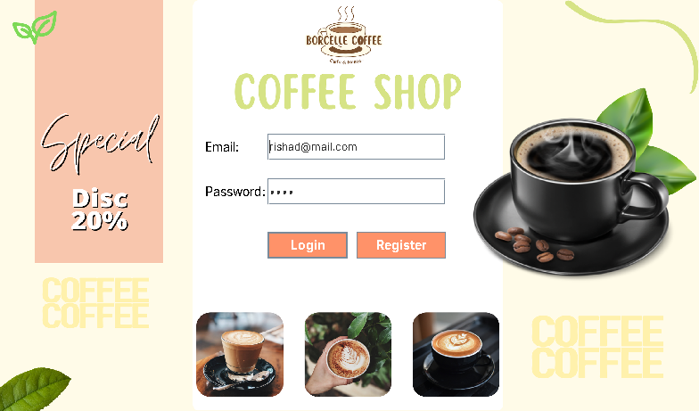
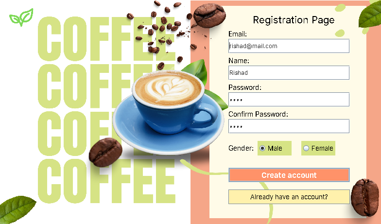
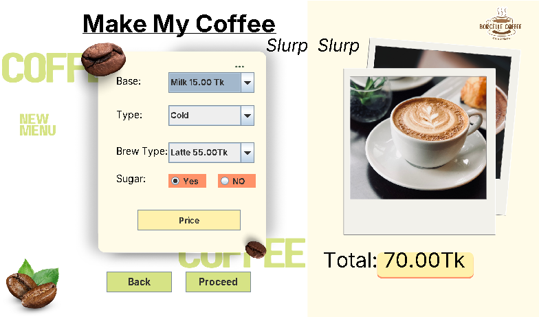
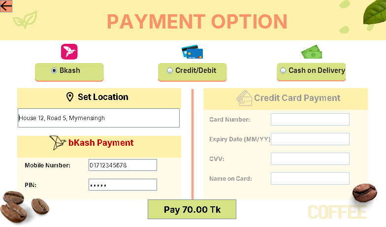

# CoffeeShopBillingManagementSystem

This is a Java-based Coffee Shop Billing Management System. It is developed using Java Swing for managing coffee orders, calculating prices, and handling payments.

**Semester:** Summer 2023-2024

## Features

- User login and registration.
- Coffee ordering system.
- Customize coffee ingredients.
- Automatic price calculation.
- Multiple payment options (bKash, Card, Cash on Delivery).
- Accounts and orders are saved in text files inside the `data` folder (no database needed).

## Requirements

- **JDK 8 or newer** – download from [Adoptium](https://adoptium.net/)
- **Git** – download from [git-scm.com](https://git-scm.com/downloads)
- **VS Code** – download from [code.visualstudio.com](https://code.visualstudio.com/)

## Clone the Project

```bash
git clone https://github.com/munshi-rishad/Java-CoffeeShopBillingManagementSystem.git
```

## Setup and Run in VS Code

1. Install **JDK** and **VS Code**. Check Java is installed by typing `java -version` in a terminal.
2. Open VS Code, go to **Extensions** (`Ctrl+Shift+X`), search **Extension Pack for Java** and install it.
3. Clone the project using the command above, then in VS Code go to **File → Open Folder** and open the `Java-CoffeeShopBillingManagementSystem` folder.
4. Open `src/Start.java` and click **Run** above the `main` method.

You can also run it from the VS Code terminal (**Terminal → New Terminal**):

```bash
javac -d out src/*.java
java -cp out Start
```

> **Note:** Always run the project from the main project folder, otherwise the images in the `assets` folder will not load.

## How to Use

1. Click **Register** and create an account.
2. **Login** with your email and password.
3. Select Base, Type, Brew Type and Sugar, then click **Price** to see the total and **Proceed**.
4. Choose a payment method, enter your location and click **Pay** to confirm the order.

## Screenshots

### 1. Login Page

Log in with your email and password.

<p align="center">
  
</p>

### 2. Registration Page

Create a new account.

<p align="center">
  
</p>

### 3. Coffee Order Page

Customize your coffee and see the total price.

<p align="center">
  
</p>

### 4. Payment Page

Choose bKash, card or cash on delivery and confirm the order.

<p align="center">
  
</p>
